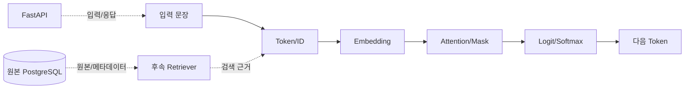

# 일일프로젝트 종합 분석 보고서: 문장 하나가 LLM 출력이 되기까지

본 보고서는 `08_daily_project`의 실습 결과물(`daily_project.json` 및 `one_page_summary.md`)과 공통 지식 베이스(`knowledge.json`)를 바탕으로, 문장이 토큰화되어 LLM의 최종 출력으로 변환되는 4단계 파이프라인의 핵심 수치와 아키텍처 연계 구조를 종합하여 정리한 문서입니다.

---

## 1. 개요 및 실습 범위

* **실습 주제**: 문장 하나가 LLM 출력이 되기까지의 4단계(토큰화 $\rightarrow$ 벡터/임베딩 $\rightarrow$ 어텐션/마스크 $\rightarrow$ 로짓/출력) 통합 분석
* **실행 범위**: 교육용 오프라인 계산 도구(`ToyTokenizer`, 수치 텐서, 코제럴 마스크, 소프트맥스)를 활용한 독립적 수치 검증
* **핵심 유의사항**: 본 실습은 대규모 사전학습된 실제 프로덕션 LLM·RAG·Agent 구현이 아니며, LLM 작동 원리의 개념적 흐름을 파악하기 위한 교육용 시뮬레이션입니다.

---

## 2. 4단계 파이프라인 데이터 분석

### ① 단계 1: 토큰화 (Tokenization & Encoding)
입력 문장인 공통 지식 A를 대상으로 규칙 기반 교육용 토크나이저를 적용한 결과입니다.
* **입력 문장**: "실습 파일은 개인 폴더에 보관합니다."
* **유효 토큰 길이**: 8 (최대 길이 제한 12 이하 충족, 잘림 현상 없음)
* **특수 토큰 및 토큰 목록**: `['[BOS]', '실습', '파일은', '개인', '폴더에', '보관합니다', '.', '[EOS]']`
* **토큰 ID 시퀀스 (`input_ids`)**: `[2, 10, 15, 5, 16, 7, 4, 3]`
* **어텐션 마스크**: 모든 토큰 위치에 대해 `1` (패딩 없음)

### ② 단계 2: 벡터 공간 및 코사인 유사도 (Vector & Cosine Similarity)
교육용 2D 좌표 벡터(`A`, `B`, `C`)를 통해 문장 간 방향성과 유사도를 측정했습니다.
* **기준 벡터 A ("실습 파일 보관")와 비교**:
  * **A와 B 간 유사도 (`A_B`)**: `0.9701` (매우 높은 방향 일치성, 유사한 맥락)
  * **A와 C 간 유사도 (`A_C`)**: `-1.0000` (반대 방향, 상반된 맥락)

### ③ 단계 3: 어텐션 메커니즘과 코제럴 마스크 (Attention & Causal Masking)
$3 \times 2$ 쿼리/키/밸류 예제에 상단 삼각형(Upper-triangle) 코제럴 마스크를 적용한 결과입니다.
* **어텐션 점수 텐서 Shape**: `[3, 3]`
* **어텐션 가중치 (`attention_weights`)**:
  $$\begin{bmatrix} 1.0 & 0.0 & 0.0 \\ 0.3302 & 0.6698 & 0.0 \\ 0.2483 & 0.2483 & 0.5035 \end{bmatrix}$$
* **행 합 검증 (`row_sums`)**: `[1.0, 1.0, 1.0]` (소프트맥스 적용으로 각 행의 확률 합이 정확히 $1.0$을 만족)
* **미래 정보 차단**: Causal Mask에 의해 미래 위치의 가중치가 정확히 `0.0`으로 마스킹됨
* **마스크 유무에 따른 차이 (`masked_unmasked_l1`)**: 마스크 적용 시와 미적용 시의 L1 차이 총합은 `2.0`으로, 미래 토큰 참조 차단에 따른 가중치 재분배 효과를 정량적으로 증명함

### ④ 단계 4: 로짓, 소프트맥스 및 다음 토큰 선택 (Logit & Generation)
출력 로짓 분포를 확률로 변환하고 디코딩 전략을 적용한 결과입니다.
* **입력 로짓 (`logits`)**: `[2.0, 1.0, 0.0]`
* **확률 변환 (`probabilities`)**: `[0.6652, 0.2447, 0.0900]` (확률의 총합은 $1.0$)
* **그리디(Greedy) 선택 결과**: 가장 높은 확률(약 $66.5\%$)을 가진 첫 번째 후보가 선택되어 **`출력A`**가 다음 토큰으로 결정됨

---

## 3. 커스텀 문장 비교 및 정량적 특징

세 가지 개인/실무 문장을 대상으로 배치 토큰화를 수행한 결과는 다음과 같습니다.
* **문장별 토큰 길이 (`custom_token_lengths`)**:
  1. "실습 기록은 개인 폴더에 보관합니다." $\rightarrow$ **8 토큰**
  2. "서버를 프로젝트 폴더에서 실행합니다." $\rightarrow$ **7 토큰**
  3. "오류 메시지와 실행 명령을 같이 적습니다." $\rightarrow$ **9 토큰**
* **시사점**: 문장의 구조와 단어 구성에 따라 유효 토큰 길이가 달라지며, 고정 길이 윈도우 환경에서는 패딩(Padding)과 트런케이션(Truncation) 처리가 필수적임을 확인함.

---

## 4. 플랫폼 아키텍처 및 책임 분리

실습에서 다룬 수치 계산 모델과 실제 엔터프라이즈 AI 서비스 플랫폼 간의 컴포넌트별 책임 매핑은 다음과 같습니다.

| 플랫폼 컴포넌트 | 핵심 책임 및 역할 |
| :--- | :--- |
| **FastAPI** | HTTP 입력 수신, 요청 스키마 검증 및 응답 반환; 지식 관리 엔드포인트 제공 |
| **PostgreSQL** | 지식 원본 데이터, 카테고리 분류 및 업데이트 이력 관리 (후속 설계 연계) |
| **LLM** | 입력된 토큰 시퀀스에 조건부로 다음 토큰의 확률 분포 생성 |
| **Retriever (RAG)** | 사용자 질문에 부합하는 관련 근거 문서 검색 및 신뢰할 수 있는 출처 제공 |
| **Agent** | 외부 도구 선택 및 다단계 실행 수행 (엄격한 권한 및 사용자 승인 절차 필수) |

*(위 흐름도는 개념적 파이프라인 위치를 나타내며, 실습 당일에 실제 외부 RAG·Agent 백엔드가 가동된 것은 아님)*

---

## 5. 기술적 한계 및 주의사항

본 분석에 사용된 도구와 모델은 교육 목적으로 간소화되어 있어 다음과 같은 명확한 한계를 지닙니다.
1. **토크나이저**: 실제 대규모 언어 모델의 복잡한 서브워드(Subword) 토크나이저가 아닌 단순 정규표현식 기반 규칙 어휘표임.
2. **벡터 공간**: 의미론적 검색 성능이 없는 임의의 2D 교육용 좌표임.
3. **어텐션**: 실제 자연어 이해를 학습한 다중 헤드(Multi-head)가 아니라 장난감 수치 예제임.
4. **로짓**: 실제 모델의 거대한 Vocabulary 분포가 아닌 3개의 임의 수치임.
5. **아키텍처 확장**: 본 실습은 RAG와 Agent의 내부 동작을 직접 구현한 것이 아니며, 이후 단계별 과목에서 연동될 예정임.

---

## 6. 면책 조항 (Disclaimer)

> *본 보고서의 분석 결과는 교육 목적으로 구성된 독립 수치 계산 및 규칙 기반 시뮬레이션에 기반하며, 실제 사전학습된 프로덕션 LLM의 추론 성능이나 자동 사실성 검사기를 의미하지 않습니다.*

---

## 7. 결론

많은 개발자들이 LLM을 마법 같은 '블랙박스'로 대하며 API 호출 결과에만 의존하는 경향이 있습니다. 하지만 본 일일프로젝트가 증명하듯, LLM의 본질은 결국 **토큰 ID의 매핑, 선형대수학적 벡터 연산, 코제럴 마스크를 통한 확률적 통제, 그리고 로짓의 소프트맥스 변환**이라는 매우 엄밀하고 건조한 수치 파이프라인의 집합입니다.

실무 시스템을 설계하는 엔지니어의 관점에서 이러한 펜앤드패드(Pen-and-Paper) 수준의 기초 원리를 직접 코드로 해체해 보는 것은 두 가지 측면에서 결정적입니다. 
첫째, **환각(Hallucination)과 프롬프트 보안 이슈**가 왜 발생하는지 그 구조적 취약점을 정확히 짚어낼 수 있습니다. 
둘째, FastAPI, PostgreSQL, RAG, 그리고 Agent로 이어지는 전체 플랫폼 아키텍처에서 **어느 지점에 신뢰 경계(Trust Boundary)를 세우고 검증 로직을 배치해야 하는지**에 대한 명확한 청사진을 그려줍니다. 

결국 진정한 AI 엔지니어링은 모델의 겉모습을 동경하는 것이 아니라, 입력에서 출력으로 이어지는 데이터의 흐름과 책임을 명확히 분리하고 통제하는 데서 시작된다는 점을 본 실습은 강력하게 시사하고 있습니다.